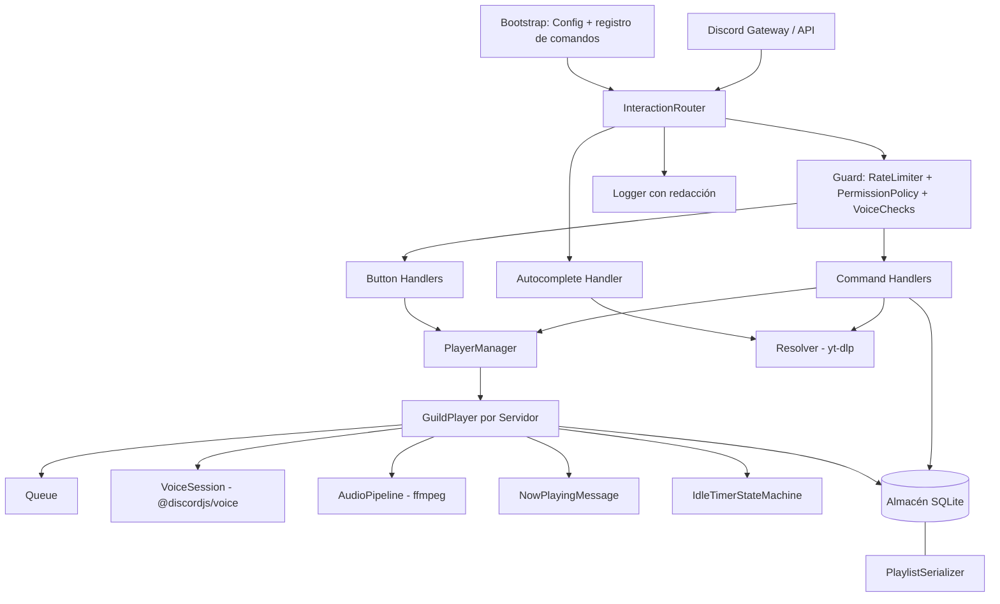
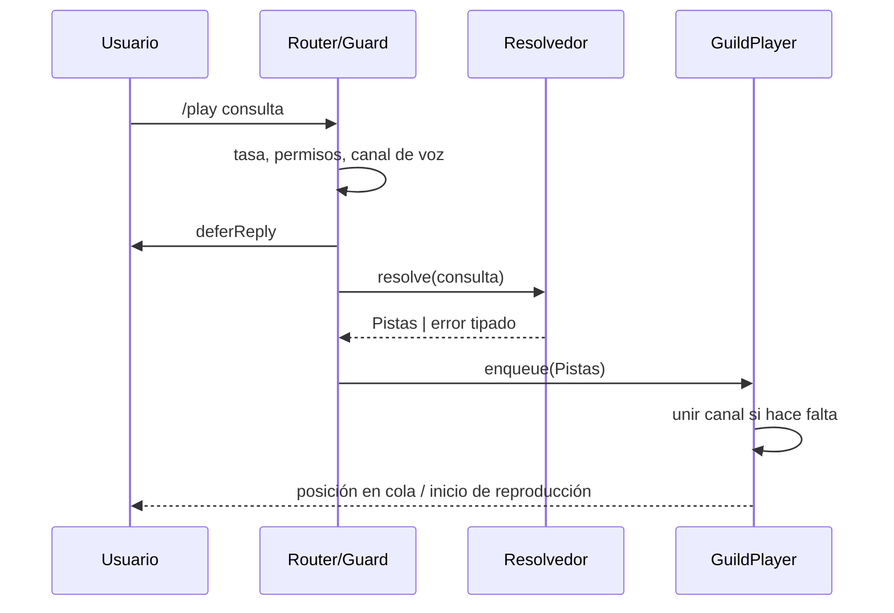
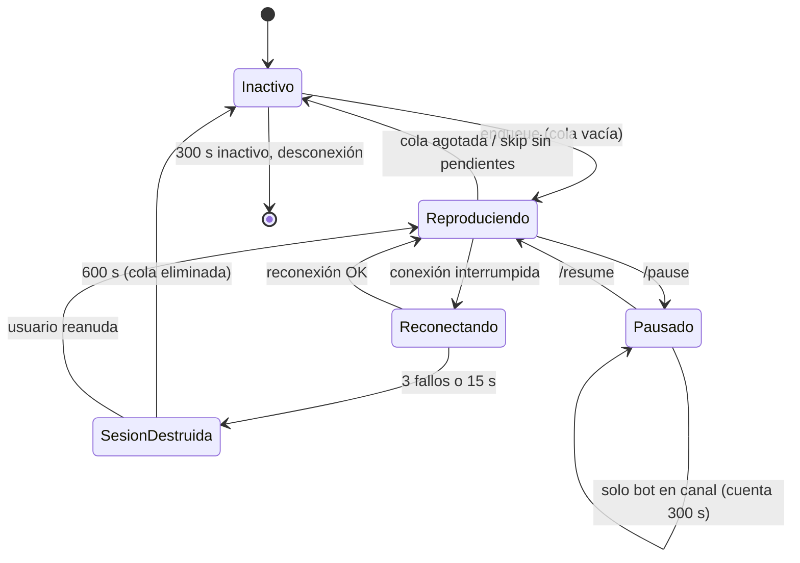
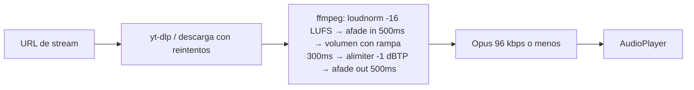

# Documento de Diseño

## Overview

El Bot es una aplicación Node.js (TypeScript) que usa `discord.js` v14 para slash commands, botones y autocompletado, y `@discordjs/voice` para la conexión y reproducción de voz. Cada Servidor tiene un `Reproductor` independiente con su Cola, Volumen, Modo_Repetición y conexión de voz. La resolución de enlaces y búsquedas se hace con `yt-dlp`, y el audio se procesa con `ffmpeg` (normalización `loudnorm`, limitador `alimiter`, fundidos `afade`, volumen y codificación Opus). La persistencia usa SQLite (`better-sqlite3`).

### Hallazgos de investigación que guían el diseño

- `@discordjs/voice` ofrece `VoiceConnection`, `AudioPlayer` y `AudioResource` con `inlineVolume`. Se usa un pipeline propio en ffmpeg y Opus ya codificado (`StreamType.OggOpus`/`Opus`), porque el volumen con rampa de 300 ms y los fundidos requieren control a nivel de muestras.
- Un `VoiceConnection` expone estados (`Ready`, `Disconnected`, `Signalling`, `Connecting`, `Destroyed`). El patrón recomendado en su documentación para detectar movimiento frente a desconexión manual es esperar a `Signalling`/`Connecting` durante unos 5 s tras `Disconnected`; esto se usa en los requisitos 9.4, 9.7 y 9.8.
- Discord exige responder a una interacción en 3 s, o diferirla con `deferReply()`. Se usa `deferReply` siempre que la operación pueda tardar (Requisito 6.7).
- Los mensajes efímeros se logran con `MessageFlags.Ephemeral` (Requisitos 6.8 y 6.10).
- `ffmpeg` `loudnorm` con `I=-16:TP=-1` hace normalización de sonoridad integrada; en una sola pasada es aproximada, por lo que se usa el modo de dos pasadas para pistas descargables, o en directo `loudnorm` con `linear=false` y se valida la tolerancia de ±1 LU en pruebas con muestras. Un `alimiter` final con `limit` equivalente a -1 dBFS y sobremuestreo cubre el techo de -1 dBTP.
- Los costes de PBT se concentran en la lógica pura (Cola, ajuste de volumen, paginación, limitador de tasa, serializador, políticas de permisos, máquina de estados de desconexión). Las llamadas a YouTube, ffmpeg y Discord se prueban con integración o mocks.

Fuentes consultadas: documentación de [discord.js](https://discord.js.org/docs), guía de [@discordjs/voice](https://discordjs.guide/voice/) y documentación de [ffmpeg-filters](https://ffmpeg.org/ffmpeg-filters.html). Este diseño se basa en conocimiento previo de esas APIs; no se hizo una búsqueda web nueva.

### Decisiones de diseño

| Decisión | Motivo |
|---|---|
| Lógica pura separada de la E/S (`Queue`, `RateLimiter`, `VolumeMath`, `PermissionPolicy`, `PlaylistSerializer`, `IdleTimerStateMachine`) | Permite pruebas basadas en propiedades sin Discord ni red. |
| Un `GuildPlayer` por Servidor, aislado en un `Map<guildId, GuildPlayer>` | Cumple el Requisito 10.6 (independencia entre Servidores). |
| Reloj y temporizadores inyectables (`Clock`) | Pruebas deterministas de plazos de 300 s, 600 s, 30 s y ventana de 10 s. |
| SQLite con una tabla de playlists que guarda las pistas como JSON | Simple, persistente y suficiente para 25 listas × 200 pistas por usuario y servidor. |
| Mensajes localizados mediante un catálogo `i18n` con claves | Requisito 6.5 (español por defecto). |
| Registro con redacción de secretos centralizada | Requisito 10.3. |

## Architecture



### Flujo de `/play`



### Máquina de estados del Reproductor



### Pipeline de audio



La estructura del orden de filtros es: `loudnorm` → `afade=in` → `volume` (rampa) → `alimiter`. El volumen se aplica antes del limitador para que ningún valor de Volumen entre 0 y 100 supere -1 dBTP (Requisito 5.7). Los cambios de volumen en vivo se aplican mediante un transformador de PCM propio entre ffmpeg y el codificador Opus, que interpola linealmente el factor de ganancia durante 300 ms. Los fundidos de pausa/reanudación (200 ms) y de salida (500 ms) usan el mismo transformador.

## Components and Interfaces

### Módulos de lógica pura (objetivo principal de PBT)

```ts
// Cola
interface Track { id: string; title: string; durationSec: number; url: string; thumbnailUrl: string; requestedBy: string }
type LoopMode = 'off' | 'track' | 'queue';

class Queue {
  readonly maxSize = 500;
  current: Track | null;
  pending: Track[];
  add(tracks: Track[]): { added: number; rejected: number; firstPosition: number };
  remove(position: number): Result<Track, 'out_of_range'>;
  shuffle(rng: () => number): void;      // solo pending
  advance(loop: LoopMode): Track | null;  // siguiente pista según repetición
  clear(): void;
}

// Volumen
function clampVolume(v: number): number;                 // 0..100
function stepVolume(v: number, delta: 10 | -10): number;  // limitado a 0..100
function parseVolumeArg(raw: unknown): Result<number, 'invalid'>; // entero 0..100
function volumeRamp(from: number, to: number, durationMs: 300, sampleRate: number): number[];

// Formato y paginación
function formatDuration(sec: number): string;             // mm:ss
function paginateQueue(q: Track[], page: number, pageSize = 10): { items: Array<{position:number; track: Track}>; page: number; totalPages: number };

// Resolución
function classifyInput(input: string): 'video_url' | 'playlist_url' | 'search' | 'invalid_url';
function truncateSuggestion(title: string, max = 100): string;

// Límite de uso
class RateLimiter { // ventana deslizante: 5 comandos / 10 s por usuario
  constructor(clock: Clock, limit = 5, windowMs = 10_000);
  check(userId: string): { allowed: true } | { allowed: false; retryAfterSec: number }; // redondeo hacia arriba
}

// Permisos
function canExecute(cmd: CommandName, member: { roleIds: string[]; isAdmin: boolean; inBotVoiceChannel: boolean }, djRoleId: string | null): Decision;
const RESTRICTED: ReadonlySet<CommandName>; // skip, stop, volume, shuffle, remove, loop

// Reglas de listas
function validatePlaylistSave(args: { name: string; trackCount: number; existingNames: string[]; userCount: number }): SaveDecision; // 'ok' | 'confirm_overwrite' | 'empty' | 'too_many_tracks' | 'too_many_playlists' | 'bad_name'

// Serializador
class PlaylistSerializer {
  serialize(p: Playlist): string;
  deserialize(json: string): Result<Playlist, { reason: string }>;
}

// Desconexión
class IdleTimerStateMachine { // 300 s solo en canal / 300 s inactivo / 600 s cola conservada
  onEvent(e: VoiceEvent, now: number): Action[];
}

// Configuración y redacción
function loadConfig(env: Record<string,string|undefined>): Result<Config, { missing: string[] }>;
function redactSecrets(text: string, secrets: string[]): string;
function formatLogEntry(e: LogEvent): string; // ISO 8601 UTC, guildId o "ninguno"
```

### Módulos con E/S (pruebas de ejemplo e integración)

| Componente | Responsabilidad | Dependencias |
|---|---|---|
| `InteractionRouter` | Despacha comandos, botones y autocompletado; aplica `deferReply` y captura errores no previstos (Req. 7.8). | discord.js |
| `Guard` | Encadena `RateLimiter`, `PermissionPolicy` y verificaciones de canal de voz y permisos de Discord. | módulos puros |
| `PlayerManager` | `Map<guildId, GuildPlayer>`; crea y destruye reproductores. | `GuildPlayer` |
| `GuildPlayer` | Orquesta Cola, `VoiceSession`, `AudioPipeline`, `NowPlayingMessage` e `IdleTimerStateMachine`. | @discordjs/voice |
| `Resolver` | Resuelve URL, búsqueda y listas con yt-dlp; devuelve errores tipados (`invalid_link`, `unavailable:{deleted|private|region}`, `age_restricted`, `no_results`, `timeout`). | yt-dlp |
| `AudioPipeline` | Lanza ffmpeg con la cadena de filtros, reintenta la descarga 3 veces cada 2 s (Req. 7.5). | ffmpeg |
| `NowPlayingMessage` | Crea, actualiza y recrea el mensaje con botones y etiquetas accesibles. | discord.js |
| `Store` | Interfaz sobre SQLite: volumen, Rol_DJ, idioma, playlists. | better-sqlite3 |
| `Bootstrap` | Carga de configuración, registro de slash commands con hasta 3 reintentos cada 10 s. | discord.js REST |
| `Logger` | Entradas con ISO 8601 UTC, tipo, descripción, guildId o "ninguno"; redacción de secretos. | — |
| `I18n` | Catálogo de mensajes por idioma (`es` por defecto). | — |

### Comandos y botones

Comandos: `/play`, `/pause`, `/resume`, `/skip`, `/stop`, `/nowplaying`, `/queue`, `/loop`, `/shuffle`, `/remove`, `/volume`, `/playlist save|load|list|delete`, `/dj set|clear`. Botones del Mensaje_de_Reproducción: pausa/reanudar, omitir, detener, repetición, volumen +, volumen −; cada uno lleva `label` y emoji con texto equivalente, y su acción pasa por el mismo `Guard` que el comando equivalente.

Permisos de Discord solicitados: `Connect`, `Speak`, `SendMessages`, `EmbedLinks` (Req. 8.8). Intents mínimos: `Guilds`, `GuildVoiceStates`.

## Data Models

```ts
interface Track {
  id: string;            // id de vídeo de YouTube
  title: string;
  durationSec: number;   // entero >= 0
  url: string;
  thumbnailUrl: string;
  requestedBy: string;   // userId
}

interface Playlist {
  name: string;          // 1..50 caracteres
  creatorId: string;
  guildId: string;
  tracks: Track[];       // 1..200, orden preservado
}

interface GuildSettings {
  guildId: string;
  volume: number;        // 0..100, por defecto 50
  djRoleId: string | null;
  language: 'es' | string; // por defecto 'es'
}
```

Esquema SQLite:

```sql
CREATE TABLE guild_settings (
  guild_id   TEXT PRIMARY KEY,
  volume     INTEGER NOT NULL DEFAULT 50 CHECK (volume BETWEEN 0 AND 100),
  dj_role_id TEXT,
  language   TEXT NOT NULL DEFAULT 'es'
);
CREATE TABLE playlists (
  guild_id   TEXT NOT NULL,
  creator_id TEXT NOT NULL,
  name       TEXT NOT NULL CHECK (length(name) BETWEEN 1 AND 50),
  tracks     TEXT NOT NULL,   -- JSON producido por PlaylistSerializer
  PRIMARY KEY (guild_id, creator_id, name)
);
```

Formato JSON de una lista: `{"version":1,"name":"...","creatorId":"...","guildId":"...","tracks":[{...Track}]}`. El serializador usa claves en orden fijo para que `serialize(deserialize(serialize(p)))` coincida con `serialize(p)`.

Estado en memoria por Servidor (`GuildPlayer`): `queue`, `loopMode`, `state` (`inactivo|reproduciendo|pausado|reconectando|sesion_destruida`), `positionSec`, `voiceChannelId`, `textChannelId`, `nowPlayingMessageRef`, `idleDeadline`, `retainedQueueDeadline`. Estado en memoria global: ventanas del `RateLimiter` por usuario y confirmaciones pendientes de sobrescritura (30 s).


## Correctness Properties

*A property is a characteristic or behavior that should hold true across all valid executions of a system-essentially, a formal statement about what the system should do. Properties serve as the bridge between human-readable specifications and machine-verifiable correctness guarantees.*

Las propiedades se aplican a la lógica pura (Cola, volumen, paginación, permisos, límite de uso, serializador, temporizadores, configuración y registro). Los criterios de temporización con Discord, YouTube o ffmpeg reales se cubren con pruebas de integración (ver Testing Strategy).

### Property 1: Clasificación de entradas de /play

Para toda cadena de entrada, `classifyInput` devuelve `video_url` o `playlist_url` solo si la cadena es una URL de YouTube válida de ese tipo, `search` si no es una URL y tiene entre 1 y 100 caracteres, e `invalid_url` si es una URL que no corresponde a un vídeo o lista de YouTube.

**Validates: Requirements 1.2, 7.1**

### Property 2: Añadir pistas respeta orden y límite de 500

Para toda Cola con `n` pistas pendientes y todo lote de pistas, `add` agrega las primeras `min(|lote|, 500 − n)` pistas del lote al final y en su orden, rechaza el resto, informa los conteos de agregadas y rechazadas, y la posición devuelta de la primera pista agregada es `n + 1`. La Cola nunca supera 500 pistas y las pistas previas no cambian.

**Validates: Requirements 1.5, 7.6, 7.9**

### Property 3: Importación de listas de YouTube

Para toda lista de YouTube con entradas disponibles y no disponibles, el resultado contiene las primeras `min(100, disponibles)` pistas disponibles en orden, y los conteos informados de agregadas y omitidas coinciden con el contenido real.

**Validates: Requirements 1.3, 7.7**

### Property 4: Los fallos de resolución no modifican la Cola

Para toda Cola y todo error del Resolvedor (enlace inválido, no disponible, sin resultados, tiempo agotado), la Cola resultante es igual a la original y el mensaje de respuesta incluye el motivo del fallo.

**Validates: Requirements 1.10, 7.1, 7.4**

### Property 5: Skip avanza a la siguiente pista

Para toda Cola con al menos 1 pista pendiente, `skip` hace que la pista actual sea la antigua primera pendiente y que las pendientes sean las restantes en el mismo orden. Para toda Cola sin pendientes, `skip` deja la reproducción inactiva.

**Validates: Requirements 2.3, 2.4**

### Property 6: Formato de duración y de /nowplaying

Para toda duración entera no negativa, `formatDuration` produce `mm:ss` que al interpretarse da la misma duración. Para toda Pista y posición, la respuesta de `/nowplaying` contiene el título, la duración total, la posición actual en `mm:ss` y la miniatura.

**Validates: Requirements 2.6**

### Property 7: Modo de repetición

Para todo modo en {`off`, `track`, `queue`}, `/loop` fija ese modo y la confirmación lo menciona. Para toda cadena fuera de ese conjunto, el modo vigente no cambia y la respuesta enumera los modos válidos.

**Validates: Requirements 2.7, 2.8**

### Property 8: Shuffle es una permutación de las pendientes

Para toda Cola y toda fuente aleatoria, `shuffle` conserva la pista actual y deja unas pendientes que son una permutación de las originales (mismo multiconjunto y mismo tamaño).

**Validates: Requirements 2.9**

### Property 9: Remove

Para toda Cola con `n` pendientes y toda posición entera `p` entre 1 y `n`, `remove(p)` devuelve la pista de la posición `p` y deja la lista original sin ese elemento, con los siguientes desplazados una posición. Para todo valor no entero o fuera de 1..`n`, la Cola queda sin cambios y se devuelve un error con el rango válido.

**Validates: Requirements 2.10, 2.11**

### Property 10: Paginación de /queue

Para toda Cola con `n ≥ 1` pendientes y toda página válida, cada página tiene como máximo 10 elementos, el total de páginas es `ceil(n/10)`, la concatenación de todas las páginas reproduce la Cola en orden con posiciones consecutivas desde 1, y el texto incluye posición, título, duración, página actual y total de páginas.

**Validates: Requirements 2.13**

### Property 11: Aplicación y consulta de Volumen

Para todo valor entero entre 0 y 100, `/volume` fija el Volumen del Servidor en ese valor, lo guarda en el Almacén y lo confirma. Para todo valor que no sea un entero entre 0 y 100 (negativos, mayores que 100, decimales, no numéricos), el Volumen y el valor guardado no cambian y la respuesta indica el rango de 0 a 100. Para todo Volumen guardado, `/volume` sin valor responde con ese valor.

**Validates: Requirements 3.1, 3.2, 3.3, 3.5**

### Property 12: Rampa lineal de volumen

Para todo par de Volúmenes `from` y `to` entre 0 y 100, la rampa de 300 ms tiene `sampleRate × 0,3` muestras, empieza en el nivel de `from`, termina en el de `to`, y las diferencias entre muestras consecutivas son constantes (dentro de la tolerancia numérica).

**Validates: Requirements 3.4**

### Property 13: Botones de volumen

Para todo Volumen `v` entre 0 y 100, subir da `min(100, v + 10)` y bajar da `max(0, v − 10)`.

**Validates: Requirements 3.9**

### Property 14: Guardar una lista conserva pistas y orden

Para todo estado con pista actual opcional y Cola, `/playlist save` con un nombre válido y reglas satisfechas guarda `[actual, ...pendientes]` en ese orden, asociada al Usuario y al Servidor, y la confirmación incluye el nombre y el número de pistas.

**Validates: Requirements 4.1**

### Property 15: Cargar una lista añade al final

Para toda Cola y toda Lista_de_Reproducción existente, `/playlist load` produce una Cola igual a la original seguida de las pistas de la lista en su orden (sujeto al límite de 500), sin alterar las pistas previas.

**Validates: Requirements 4.2**

### Property 16: Listado de listas

Para todo conjunto de listas de varios Usuarios y Servidores, `/playlist list` devuelve exactamente las listas del Usuario en ese Servidor, ordenadas alfabéticamente por nombre, con su número de pistas.

**Validates: Requirements 4.3**

### Property 17: Validación de guardado

Para todo nombre, número de pistas, conjunto de nombres existentes y número de listas del Usuario, `validatePlaylistSave` devuelve: `bad_name` si el nombre no tiene 1 a 50 caracteres; `empty` si no hay pistas; `too_many_tracks` si hay más de 200; `confirm_overwrite` si el nombre ya existe; `too_many_playlists` si el nombre es nuevo y el Usuario ya tiene 25; `ok` en otro caso. Solo `ok` y una confirmación explícita en 30 s permiten modificar el Almacén.

**Validates: Requirements 4.6, 4.8, 4.10, 4.11**

### Property 18: Acceso a listas por nombre y creador

Para toda operación `load` o `delete` sobre un nombre inexistente, la Cola y el Almacén no cambian y se informa de que no existe. Para todo `delete` de una lista cuyo creador es otro Usuario, el Almacén no cambia. Para todo `delete` de una lista propia, la lista deja de existir y las demás no cambian.

**Validates: Requirements 4.5, 4.7, 4.9**

### Property 19: Persistencia de listas tras reinicio

Para todo conjunto de listas guardadas, cerrar y reabrir el Almacén devuelve las mismas listas con nombre, creador, Servidor y pistas en el mismo orden.

**Validates: Requirements 4.12**

### Property 20: Ida y vuelta del serializador

Para toda Lista_de_Reproducción válida, `deserialize(serialize(p))` es equivalente a `p`, y `serialize(deserialize(serialize(p)))` es igual a `serialize(p)`.

**Validates: Requirements 4.13, 4.14**

### Property 21: JSON inválido

Para toda cadena que no sea JSON válido o cuyo contenido no cumpla el esquema de Lista_de_Reproducción, `deserialize` devuelve un error con el motivo, no lanza excepciones y no modifica el Almacén.

**Validates: Requirements 4.15**

### Property 22: Selección de tasa de bits

Para todo máximo de tasa de bits del Canal_de_Voz, la tasa de codificación Opus es `min(96 kbps, máximo)`.

**Validates: Requirements 5.6**

### Property 23: Una pista fallida se omite y la Cola continúa

Para toda Cola y todo fallo de una pista (procesamiento, no disponible por eliminada/privada/región, restricción de edad, o descarga fallida tras 3 reintentos), el Reproductor notifica el título y el motivo, omite esa pista, conserva el resto de la Cola en orden y continúa con la siguiente. Si no quedan más pistas, la reproducción se detiene y la conexión de voz se mantiene.

**Validates: Requirements 5.8, 5.9, 7.2, 7.3, 7.5**

### Property 24: Reintentos de descarga

Para todo número `k` de fallos consecutivos de descarga, la pista se reproduce si `k ≤ 3`, con reintentos separados por 2 s, y se omite con aviso si `k > 3`.

**Validates: Requirements 7.5**

### Property 25: Mensaje_de_Reproducción

Para toda Pista y estado de reproducción, el modelo del Mensaje_de_Reproducción contiene título, duración, solicitante, miniatura y los seis botones (pausa/reanudar, omitir, detener, repetición, volumen más, volumen menos), cada uno con una etiqueta de texto no vacía. Cuando la Cola ha terminado, el modelo indica que la reproducción finalizó y todos los botones están desactivados.

**Validates: Requirements 6.1, 6.6, 6.9**

### Property 26: Sugerencias de autocompletado

Para toda lista de resultados de búsqueda, las sugerencias devueltas son como máximo 5, conservan el orden, cada una tiene un título de como máximo 100 caracteres y una duración.

**Validates: Requirements 6.4**

### Property 27: Catálogo de idioma

Para toda clave de mensaje y todo idioma configurado, el mensaje se obtiene del catálogo de ese idioma si existe y, si el idioma no está disponible o no está configurado, del catálogo en español. Todas las claves existen en español.

**Validates: Requirements 6.5**

### Property 28: Decisión de permisos

Para todo Comando, miembro y configuración de Rol_DJ, `canExecute` permite el Comando si y solo si: (a) hay Rol_DJ y el Comando no es restringido o el miembro tiene el Rol_DJ o es administrador, o (b) no hay Rol_DJ y el miembro está en el Canal_de_Voz del Bot. La decisión de un botón es idéntica a la del Comando equivalente. Un rechazo no modifica el estado de la Cola ni de la reproducción.

**Validates: Requirements 6.3, 8.1, 8.2, 8.6**

### Property 29: Configuración del Rol_DJ

Para toda secuencia de operaciones `/dj set` y `/dj clear` ejecutadas por administradores, el Rol_DJ almacenado es el del último `set` o nulo tras un `clear`. Para toda operación ejecutada por un no administrador, el Rol_DJ almacenado no cambia.

**Validates: Requirements 8.3, 8.4, 8.5**

### Property 30: Límite de uso por ventana deslizante

Para toda secuencia de comandos de un Usuario con marcas de tiempo no decrecientes, un comando se permite si y solo si hay menos de 5 comandos permitidos en los 10 s anteriores. Cuando se rechaza, el tiempo de espera informado es `ceil((tiempo del comando más antiguo de la ventana + 10 s − ahora))` en segundos. Los comandos rechazados no modifican el estado.

**Validates: Requirements 8.7**

### Property 31: Máquina de desconexión y retención de Cola

Para toda secuencia de eventos de voz y de Cola con marcas de tiempo, la máquina `IdleTimerStateMachine`: pausa y desconecta tras 300 s continuos con el Bot como único participante; cancela la desconexión y reanuda si un Usuario se une antes; desconecta tras 300 s con Cola vacía y sin reproducción, y cancela el temporizador si se añade una pista antes; tras destruir la sesión conserva la Cola durante 600 s y después la elimina.

**Validates: Requirements 9.1, 9.2, 9.3, 9.5, 9.6**

### Property 32: Reconexión de voz

Para todo patrón de éxitos y fallos de reconexión, el Reproductor hace como máximo 3 intentos dentro de 15 s; si uno tiene éxito, reanuda en la posición de la interrupción con tolerancia de 2 s; si los 3 fallan o se agotan los 15 s, destruye la sesión y avisa al canal de texto.

**Validates: Requirements 9.4, 9.5**

### Property 33: Carga de configuración

Para todo entorno y todo conjunto de variables obligatorias, `loadConfig` devuelve configuración válida si y solo si todas están presentes y no vacías; en otro caso devuelve un error cuya lista de nombres es exactamente la de las variables ausentes o vacías.

**Validates: Requirements 10.2**

### Property 34: Redacción de secretos

Para todo texto (mensaje de error, entrada de registro) y todo conjunto de secretos no vacíos, `redactSecrets` produce una salida que no contiene ningún secreto, incluso si el texto lo contenía varias veces o dentro de otra cadena.

**Validates: Requirements 10.3**

### Property 35: Formato de entradas de registro

Para todo evento registrable, la entrada contiene una marca de tiempo ISO 8601 UTC válida, el tipo de evento, la descripción del error si aplica y el identificador de Servidor; si el evento no tiene Servidor, el campo es "ninguno".

**Validates: Requirements 10.4, 10.5**

### Property 36: Respuesta a errores no previstos

Para todo error lanzado por un manejador de Comando, la respuesta al Usuario es el mensaje genérico, sin contenido de la traza, rutas ni mensaje interno del error, el registro incluye nombre del Comando, identificador de usuario y de Servidor, y el procesamiento de Comandos posteriores continúa.

**Validates: Requirements 7.8**

### Property 37: Aislamiento entre Servidores

Para todo conjunto de Servidores con estado propio y toda operación (comando, error o detención) aplicada a uno, el estado de los demás (Cola, posición, pausa, Volumen, Modo_Repetición) no cambia.

**Validates: Requirements 10.6**

## Error Handling

| Situación | Origen | Respuesta | Estado tras el error |
|---|---|---|---|
| Usuario fuera de canal de voz / en otro canal | `Guard` | Mensaje con el canal en uso o instrucción de unirse | Sin cambios |
| Falta de permisos Discord (Connect/Speak) | `VoiceSession` | Mensaje con el permiso faltante | Sin cambios |
| Enlace inválido, sin resultados, tiempo de YouTube agotado (10 s) | `Resolver` (errores tipados) | Mensaje con el motivo en ≤ 5 s | Cola sin cambios |
| Pista eliminada, privada, bloqueada o con restricción de edad | `Resolver`/`AudioPipeline` | Aviso con título y motivo; se omite y se continúa | Resto de la Cola intacto |
| Descarga fallida | `AudioPipeline` | 3 reintentos cada 2 s; luego aviso y omisión | Igual |
| Fallo de ffmpeg | `AudioPipeline` | Aviso con título; omisión; si no quedan pistas, detener y mantener conexión | Conexión de voz activa |
| Cola con 500 pistas | `Queue.add` | Rechazo con el límite, o adición parcial con conteos | Pistas previas intactas |
| Fallo al guardar volumen | `Store` | El volumen se aplica y se avisa de que no se guardó | Sin persistencia |
| JSON de lista inválido | `PlaylistSerializer` | `Result` de error con motivo | Almacén sin cambios |
| Caída de conexión de voz | `VoiceSession` | 3 intentos en 15 s; si fallan, destruir sesión y avisar | Cola retenida 600 s |
| Edición del Mensaje_de_Reproducción falla | `NowPlayingMessage` | Publicar uno nuevo en ≤ 5 s | Reproducción continúa |
| Límite de uso superado | `RateLimiter` | Mensaje con segundos restantes (redondeo hacia arriba) | Sin cambios |
| Fallo de registro de slash commands | `Bootstrap` | Registro del fallo y hasta 3 reintentos cada 10 s | Bot sin comandos hasta lograrlo |
| Variable de entorno ausente/vacía | `loadConfig` | Salida en ≤ 5 s con código distinto de cero y los nombres en stderr | No se conecta a Discord |
| Error inesperado en un Comando | `InteractionRouter` | Mensaje genérico; el error completo se registra | Bot operativo |

Los errores del dominio se modelan como valores (`Result<T, E>`), no como excepciones, y solo los fallos imprevistos llegan al manejador global. Todo texto saliente (respuestas y registros) pasa por `redactSecrets`.

## Testing Strategy

### Enfoque dual

- **Pruebas basadas en propiedades**: verifican las 37 propiedades anteriores sobre la lógica pura y los componentes con E/S simulada.
- **Pruebas unitarias de ejemplo**: casos concretos y bordes (por ejemplo, `/play` sin canal de voz, comandos sin reproducción activa, `/playlist list` vacío, volumen por defecto 50, fallo al guardar volumen, mensajes efímeros de consulta, autocompletado con tiempo agotado, recreación del Mensaje_de_Reproducción).
- **Pruebas de integración** (1 a 3 ejemplos cada una, no PBT): resolución real con yt-dlp, conexión de voz, plazos de respuesta (3 s, 5 s), pausa/reanudación con precisión de ±1 s, movimiento y desconexión del Bot por un moderador (Req. 9.7, 9.8), registro de slash commands (Req. 9.9).
- **Pruebas de audio con ffmpeg** (no PBT por su coste): archivos de muestra medidos con `ebur128`/`astats` para -16 LUFS ±1 LU, techo de -1 dBTP con Volumen 0, 50 y 100, y fundidos de 500 ms y 200 ms.
- **Prueba de humo**: permisos de Discord solicitados (Connect, Speak, Send Messages, Embed Links).

### Configuración de PBT

- Biblioteca: [`fast-check`](https://fast-check.dev/) con `vitest` como ejecutor; no se implementa PBT desde cero.
- Cada propiedad se implementa con una única prueba basada en propiedades, con un mínimo de 100 iteraciones (`numRuns: 100`).
- Cada prueba lleva un comentario con la etiqueta: **Feature: discord-music-bot, Property {número}: {texto de la propiedad}**.
- Reloj (`Clock`) y temporizadores falsos para las propiedades 24, 30, 31 y 32; almacén SQLite en memoria (`:memory:`) o archivo temporal para las propiedades 11, 14 a 19 y 29.
- Los generadores incluyen casos límite: Colas vacías y de 500 pistas, títulos con caracteres Unicode y emojis, nombres de 1 y 50 caracteres, volúmenes 0 y 100, valores decimales y negativos, y JSON truncado o con tipos incorrectos.

### Criterios no cubiertos por PBT

Los criterios de temporización con servicios externos (1.1, 1.4, 1.6, 2.1, 2.2, 6.2, 6.7, 9.7, 9.8, 9.9), los del procesamiento de audio (5.1 a 5.5, 5.7) y la configuración de permisos (8.8) se cubren con pruebas de integración, de humo o de ejemplo porque su comportamiento no varía de forma útil con la entrada o dependen de servicios externos costosos.
